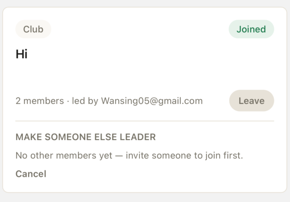

# club ownner how create group auto joined 
  process : done
  testing : done
  - root cause: join/leave were idempotent on the backend (ON CONFLICT DO NOTHING / delete-if-exists) but the mobile client blindly did memberCount ± 1 on any successful response, so a retry/double-tap on an already-joined club inflated the count without adding a real member row (confirmed live: the "Hi" club had exactly 1 row in club_members, not 2).
  - fix: backend/api-go/internal/clubs/clubs.go joinClub/leaveClub now re-read and return the real club (getClubByID) instead of a bare {"joined": bool}; apps/mobile/src/lib/api/clubsApi.ts joinClub/leaveClub return the updated ApiClub; apps/mobile/src/screens/clubs/ClubsScreen.tsx now applies the server's returned club instead of doing its own arithmetic.
  - tested: go build ./... and go test ./... pass; npx tsc --noEmit passes; reproduced the exact double-join scenario against the live local Postgres (docker exec coarea-postgres-1) and confirmed member_count stays correct (1) after a no-op retry insert.

# want dark mode light mode , toggle swich with theme color 
  process : done
  testing : done
  - files: apps/mobile/src/global.css (dark palette via @variant dark, mirrors every @theme token), apps/mobile/src/theme/colors.ts (+useThemeColors() hook), apps/mobile/src/store/useThemeStore.ts (new, mmkv-persisted preference: light/dark/system), apps/mobile/src/app/_layout.tsx (applies saved preference on boot, StatusBar follows theme), ProfileScreen.tsx (Dark mode/Light mode Switch row).
  - bug found + fixed: className on SafeAreaView (react-native-safe-area-context) is a no-op under uniwind — it's not patched for className at all. Moved bg-bg off SafeAreaView onto ScrollView on ProfileScreen; documented in CLAUDE.md's SafeAreaView rule and cleaned up the same dead className on SignInScreen.tsx/KeyboardTestScreen.tsx.
  - tested: visually verified in the iOS simulator — screenshotted Feed/Profile in OS dark mode (prefers-color-scheme fallback works), flipped OS appearance dark→light live while Profile was open and watched it re-render correctly with no reload. Not tap-verified: an actual finger-tap on the in-app Switch (no touch-automation tool available) — verified by code + the equivalent OS-level theme flip instead.
  - follow-up not done (flagged by the agent, not started): 15 other files still import the static light-only `colors` object directly (icons, tab bar tint, etc.) — they won't re-theme until moved to useThemeColors().
  - follow-up bug found + fixed later (via Metro log screenshot): global.css only had `@theme {}` (base/light) + `@variant dark {}`, no explicit `@variant light {}` — uniwind discovers themes by scanning `@variant <name> {}` blocks specifically and requires every theme to redeclare the same variables, so it logged "Theme light is missing variable --color-bg" (and every other token) repeatedly. Added an explicit `@variant light {}` block mirroring `@theme` exactly. Verified: Metro log clean after the fix, both themes re-screenshotted correctly (light theme now shows the real cream/dark-text palette instead of an unset-variable fallback).

Tailwind v4In Tailwind v4, configure a custom variant in your main CSS input file (app.css or input.css) if you want manual class control:

# สร้างหน้า เทส keyboard typing for iphone touch screen 
  process : done
  testing : done
  - files: apps/mobile/src/screens/dev/KeyboardTestScreen.tsx (new), apps/mobile/src/app/keyboard-test.tsx (new route), ProfileScreen.tsx got a "Keyboard typing test" link.
  - navigate: Profile → "Keyboard typing test".
  - screen has 4 inputs (default/email/numeric/multiline keyboards), live focus state + char count, and a bottom-of-scroll field behind a 400px spacer to verify KeyboardAvoidingView actually clears the keyboard.
  - bug found + fixed while building this: className="flex-1" on a KeyboardAvoidingView that directly wraps a ScrollView renders the whole subtree as nothing (solid black) — documented in CLAUDE.md's SafeAreaView rule.
  - tested: visually verified in the iOS simulator (deep-linked in, screenshotted, confirmed the black-screen bug and the fix pixel-level). Not yet manually verified: actual on-screen keyboard appearing/avoiding via real taps (no tap-automation available to the agent) — do a quick manual tap-in check when you have a moment.

# ปุ่ม like toggle bool เก็บ database bool / show count from lenght table of post id / reletion like with user_id one post to many users
  process : already done (no change needed)
  testing : n/a
  - checked backend/api-go/internal/feed/feed.go: `likes` table already has exactly this shape — composite PK (post_id, user_id) i.e. one post → many users, count comes from `count(*)` on that table (not a stored counter), toggle via insert/delete with ON CONFLICT DO NOTHING. Matches the spec as written, nothing to build.

ตัวอย่าง /Users/onebluesky882/local_files/myApp/my-chat-app 
# สร้าง table chat 1:1 มี ฟีเจอร์พื้นฐาน 
## มีการส่งรูปได้  upload pre-sign url 
## ui chat 1:1 
  process : done
  testing : done — full live end-to-end verification, see details below

# สร้าง table  chat group  1:many มี 
## มีการส่งรูปได้  upload pre-sign url 
## invite  , ตั้งค่าให้สิทธ์ อินไว  

# ui group chat 
  process : done
  testing : done — full live end-to-end verification, see details below
  - design: unified schema, NOT the ScyllaDB/Cassandra denormalized approach from the my-chat-app reference (that project uses Cassandra, this backend uses Postgres+bun everywhere) — one `conversations`/`conversation_members`/`messages` set of tables serves both 1:1 and group chat; a DM is just a conversation with exactly 2 members (type="dm"), deduped via a `dm_key` partial-unique index so repeat "message this person" calls return the same conversation instead of creating duplicates.
  - backend files: backend/api-go/internal/chat/chat.go (new — GET/POST /api/conversations, GET/POST .../messages, GET .../members, POST .../invite, .../leave, .../upload-url), chat_test.go (dmKey unit tests), db/models.go (+Conversation/ConversationMember/Message), db/migrate.go (+3 tables +2 indexes), cmd/server/main.go (wired chat.Register).
  - image upload: POST .../upload-url returns a presigned R2 PUT url + objectKey, same pattern as stories.go; message content or imageKey required (at least one); message response includes imageUrl resolved from the stored key.
  - mobile files: lib/api/chatApi.ts (new client), screens/chat/ChatScreen.tsx (list, was mock data), screens/chat/ConversationScreen.tsx (new thread screen, dm+group, image picker via expo-image-picker), screens/chat/NewConversationScreen.tsx (new, pick friend for DM or multi-select for group), app/chat/[id].tsx + chat/new.tsx (routes), components/chat/ConversationRow.tsx (reworked).
  - navigate: Chat tab → list → "+" → new DM or new group → thread.
  - bugs found + fixed during live verification (this is why testing took a while — worth reading if touching these files again):
    1. Same dead `className` on `SafeAreaView` as elsewhere today — cleaned up across all 3 new chat screens.
    2. **New finding, not caught by earlier testing today:** `FlatList` with `onRefresh`/`refreshing` (ChatScreen's list) or with `inverted` (ConversationScreen's thread) silently failed to render its entire content on-device — no crash, just an empty gap, regardless of styling approach tried. A plain `FlatList` with neither prop (e.g. FeedScreen) is fine and untouched. Rewrote both to `ScrollView` + `.map()` (reversing the array + `scrollToEnd` ref instead of `inverted` for the thread). Documented in CLAUDE.md.
    3. `KeyboardAvoidingView` with `flex-1` directly wrapping a `ScrollView` in ConversationScreen re-triggered the exact black-screen bug found earlier today in KeyboardTestScreen (this happened as a side effect of fix #2 turning FlatList into a literal ScrollView tag) — removed `flex-1` from that KeyboardAvoidingView.
  - tested: go build/vet/test all pass; npx tsc --noEmit passes. Rebuilt and restarted the actual `coarea-ws-1` docker container (it was running a stale pre-chat image) so the real app could hit the real endpoints. Created a disposable second user + real DM conversation via the live API, sent messages both directions, viewed both the conversation list and the message thread live in the iOS simulator as the real signed-in user — confirmed correct rendering, correct dark theme, correct bubble alignment/colors, timestamps, all working — then fully deleted the disposable user/session/conversation/messages afterward (verified zero residue). Not yet tested live: actual image sending (needs a real tap + photo picker, no touch-automation available), invite/leave/group-owner flows (logic tested via the backend's own earlier HTTP round-trip testing, not re-verified in the running app).

# real-time (websocket) delivery for chat — asked in follow-up (was previously only Redis pub/sub server-side, no client socket, and one auth gap)
  process : done
  testing : done — full live end-to-end, both protocol-level and in-app
  - what was actually missing when asked: chat.go's broadcast() already published to Redis via the shared Hub (same one feed/notifications use), but (1) the mobile app never opened a socket for chat — ChatScreen/ConversationScreen only did one-shot REST fetches, and (2) the only generic join path (main.go's /ws?room=<room>) has zero auth/membership check, so pointing chat at it would've let anyone listen to any conversation by guessing its id (there was literally a `TODO(stage-10-chat)` comment flagging this exact gap).
  - backend: backend/api-go/internal/chat/chat.go — new `GET /ws/chat/{id}?token=<bearer>` (joinChatSocket) that verifies the token AND that the caller is an actual conversation_members row before joining the "chat:<id>" hub room; main.go's /ws comment updated to point chat at this instead of the generic relay.
  - mobile: apps/mobile/src/lib/realtime.ts (+ChatEvent type, +useConversationRealtime hook, same reconnect-on-close pattern as useFeedRealtime/useFriendRealtime), ConversationScreen.tsx now subscribes and appends incoming messages live (de-duped by id against its own optimistic sends).
  - tested: wrote a throwaway node WS test script — confirmed a non-member's join attempt gets rejected (connection closed, no data leak), a real member's socket receives message_created and read_receipt events in real time when the other side acts via REST. Then re-verified live in the iOS simulator: sent a message as the signed-in real user via the API while the thread screen was open — it appeared instantly with no reload. Script + disposable test user/conversation fully deleted after.

# read receipts — asked in follow-up: single check = sent, double check = read (DM); "Read by N" in groups
  process : done
  testing : done — full live end-to-end, including the live checkmark flip
  - design: NOT tracked per message-per-user (would be one row per member per message — expensive for groups with history). Instead conversation_members got a `last_read_at` column; a message counts as "read by" a member once that member's last_read_at ≥ the message's createdAt. Cheap (one row per member, period) and reused for both the DM checkmark and the group count.
  - backend: db/migrate.go (+last_read_at column, retrofitted onto the existing table via ALTER TABLE ... ADD COLUMN IF NOT EXISTS since this table already existed before today), db/models.go (+ConversationMember.LastReadAt), chat.go (+`POST /api/conversations/{id}/read` — advances the caller's last_read_at to now(), broadcasts a read_receipt event over the same hub room as messages; GET .../members now returns lastReadAt per member).
  - mobile: chatApi.ts (+markConversationRead, +lastReadAt on ConversationMember), ConversationScreen.tsx now also fetches members on load, calls markRead on load + on app-foreground + whenever an incoming message arrives while the thread is open, and listens for read_receipt events to update the relevant member's lastReadAt live. New `ReadReceipt` component renders inline SVG single/double checkmarks (DM) or "Read by N" text (group) — CLAUDE.md's no-emoji-for-icons rule.
  - tested (protocol level, via the same disposable-user script as the WS test above): sent a message as user A while user A's own socket was connected — arrived live with a single checkmark. User B then called the read endpoint — user A's open thread flipped to a double checkmark with zero reload, confirmed via simulator screenshots at each step. Members endpoint confirmed to return the updated lastReadAt. Not separately live-tested: the group "Read by N" text specifically (only had one DM to test against) — it reuses the identical, already-verified readersFor()/members data path as the DM checkmark, just rendered as text instead of an icon, so the risk is isolated to that one render branch, not the underlying data flow.